<p align="center">
  <picture>
    <source media="(prefers-reduced-motion: reduce) and (prefers-color-scheme: dark)" srcset="./docs/assets/hostty-dark-static.svg">
    <source media="(prefers-reduced-motion: reduce)" srcset="./docs/assets/hostty-light-static.svg">
    <source media="(prefers-color-scheme: dark)" srcset="./docs/assets/hostty-dark.svg">
    
  </picture>
</p>

# Hostty

Ghostty without the "G". Hostty shows each process through libghostty-vt, the terminal engine of [Ghostty](https://ghostty.org), and it serves your local hosts in a terminal.

### Contents

- [Installation](#installation)
- [Quick Start](#quick-start)
- [Documentation](#documentation)
- [License](#license)

Hostty starts the processes of a project, such as a Rails server, a Jekyll site, and Solid Queue, and shows each one in its own tab. It can give any process a local domain with SSL, such as `https://shop.test`, through [ruby-nginx](https://github.com/bert-mccutchen/ruby-nginx).

<p align="center">
  
</p>

Hostty adds the domains before it starts any process, in your real terminal, so a password prompt works. Each process runs in its own terminal inside hostty, so `binding.irb`, `debugger`, and password prompts work inside a process too.

## Installation

Hostty needs Ruby 3.2 or later, on macOS or Linux.

```shell
gem install hostty
```

The gem for macOS and Linux, on both ARM and Intel, includes [libghostty-vt](https://lib.ghostty.org/vt/), which shows each process in its tab. On another platform, install libghostty-vt with your package manager, or use the [plain output](./docs/features/plain-output.md).

## Quick Start

1. Add a `.hostty.yml` file to the root of your project:

   ```yaml
   processes:
     web:
       command: "bin/rails server -p $PORT"
       domain: "shop.test"
       ssl: true
     docs: "bundle exec jekyll serve --port $PORT"
     jobs: "bin/jobs"
   ```

2. Run hostty from the same directory:

   ```shell
   hostty
   ```

3. Open `https://shop.test` in a browser.
4. Press Ctrl-C twice to stop every process and quit.

## Documentation

- [Features](./docs/features/README.md): the config file, the command line, domains, tabs, and stopping.
- [Development](./docs/development/README.md): setup, tests, and how hostty works.

## License

Hostty is open source under the [MIT License](https://opensource.org/licenses/MIT). The gems with libghostty-vt inside also include code under other licenses, listed in the [third-party notices](./THIRD_PARTY_NOTICES.txt).
