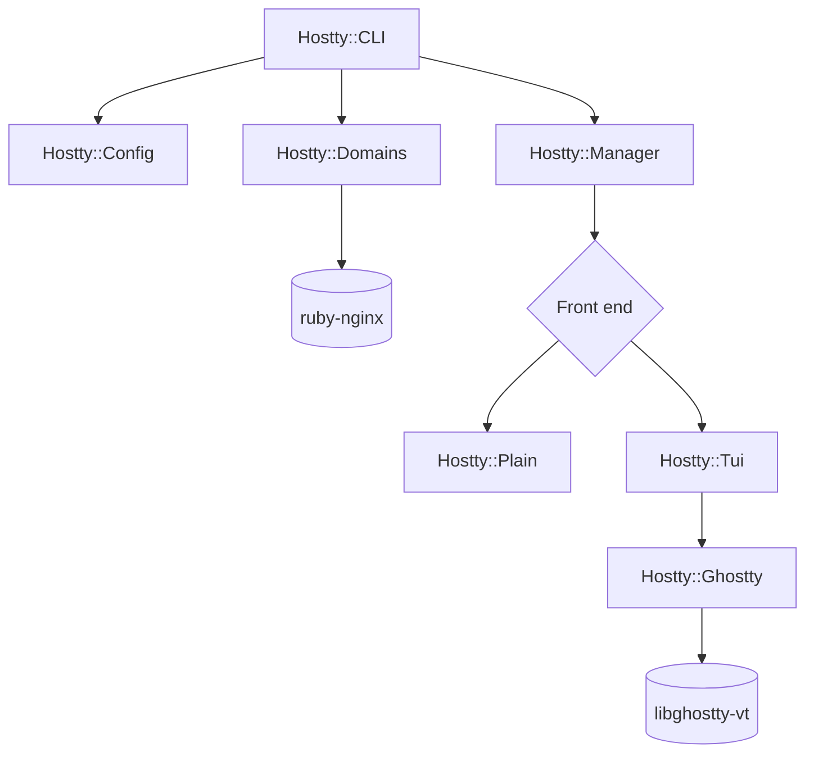
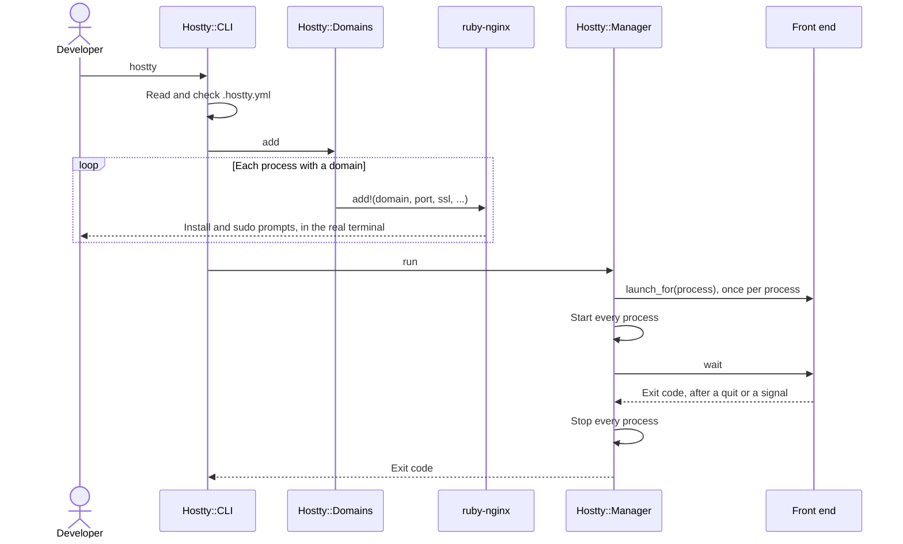
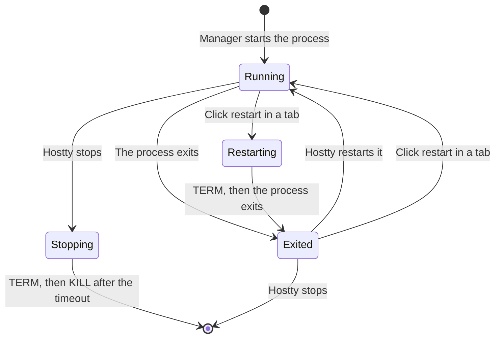
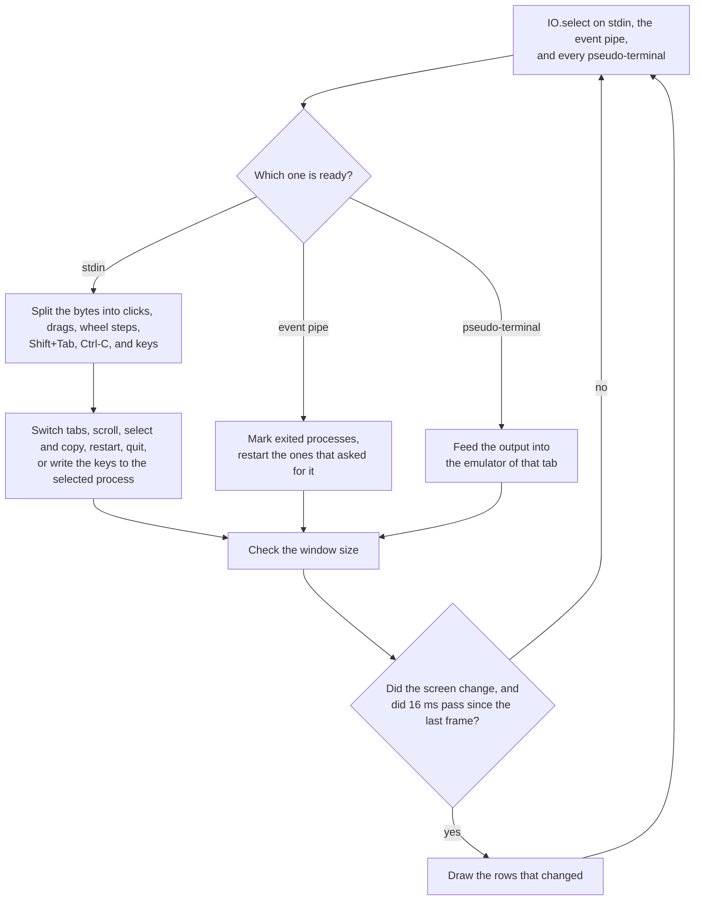
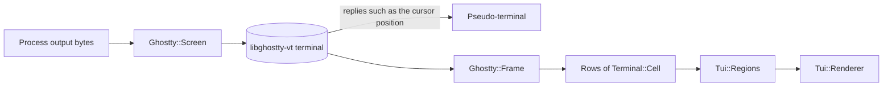

  <picture>
    <source media="(prefers-color-scheme: dark)" srcset="../assets/hostty-dark.svg">
    
  </picture>

# Architecture

### Contents

- [Components](#components)
- [Startup](#startup)
- [Front Ends](#front-ends)
- [Process Lifecycle](#process-lifecycle)
- [The Tab Event Loop](#the-tab-event-loop)
- [The Terminal Emulator](#the-terminal-emulator)
- [Signals](#signals)

## Components

| Namespace | Job |
| --- | --- |
| `Hostty::CLI` | Parses the options, picks the front end, and runs the steps in order. |
| `Hostty::Config` | Holds the processes and the startup notices. `Hostty::Config::Loader` reads `.hostty.yml`, checks every setting through the rules in `Hostty::Config::Rules`, and picks the ports. |
| `Hostty::PortChooser` | Picks the port of each process, checks that it can open the port, and stops or moves on a clash. |
| `Hostty::Domains` | Builds the ruby-nginx options of each process with a domain, and adds the domain through ruby-nginx. |
| `Hostty::Manager` | Starts the processes, waits for exit events, and runs the [stop sequence](../features/stopping.md). |
| `Hostty::Plain` | The front end for [plain output](../features/plain-output.md). It runs each process on a pipe and prints its lines. |
| `Hostty::Tui` | The front end for [tabs](../features/tabs.md). It runs each process in a pseudo-terminal and draws the tabs. |
| `Hostty::Ghostty` | The [terminal emulator](../features/terminal-emulator.md) for each tab, through libghostty-vt. |
| `Hostty::Terminal` | The cells and styles that the tab renderer draws. |

## Startup

Hostty adds the domains before the manager starts, so a prompt from ruby-nginx always shows in the real terminal, before the tabs take it over.

## Front Ends

`Hostty::Manager` does not know how a process shows its output. It asks the front end for two things:

- A launcher for each process, from `launch_for(process)`:
  - `start(process)` runs the process with its environment, including `PORT`, as the leader of its own process group, and returns its process ID. A signal to the group also reaches the children of the process.
  - `finish` releases what the launcher holds, after the process exits.
- A wait, `wait(manager)`, which returns when hostty should stop, with the exit code of the stop event.

| Front end | Launcher | Wait |
| --- | --- | --- |
| `Hostty::Plain` | Runs the process on a pipe, in its own process group, with stdin from `/dev/null`. A thread reads each line and prints it with the process name. | Returns at the first exit event or signal. |
| `Hostty::Tui` | Runs the process in a pseudo-terminal, as the leader of its own session. | Runs the [tab event loop](#the-tab-event-loop) until you quit or a signal comes in. |

The [contract tests](./README.md#tests) check this contract for each front end and launcher.

## Process Lifecycle

- A thread per process waits for its exit and puts an exit event on a queue.
- The same queue gets an event for each INT, TERM, and HUP signal.
- The queue also writes a byte to a pipe for each event, so the tab event loop can wait on the queue with `IO.select`.
- The manager tracks which processes still run from the exit events, so the stop sequence knows what to wait for.

## The Tab Event Loop

- One thread runs the loop. Only the exit waiters run on other threads.
- The loop redraws at most about 60 times a second. The screen is three regions in `Tui::Regions`: the tab bar, the pane view, and the help bar. Each region draws its rows and takes the clicks inside it. `Tui::Renderer` writes only the rows that changed since the last frame, in one write.
- On start, the loop switches your terminal to raw mode, the alternate screen, and mouse reporting with drags. On exit, it restores all three, even after an error.
- `Tui::Input` turns the bytes from stdin into events in `Tui::Events`, and the loop applies each one to `Tui::Controls`. Each mouse report becomes a `Tui::MouseEvent`. When the program in the selected tab turned on mouse reporting, events inside the tab go to the program. `Ghostty::Mouse` encodes them with the libghostty-vt mouse encoder, which follows the mouse mode and format that the program asked for. Without mouse reporting, a wheel step on the alternate screen becomes arrow keys, and on the main screen it scrolls the history.
- A drag in the output makes a `Tui::Selection` on the selected pane. `Tui::Mouse` tracks the drag in two states, idle and selecting. On release, `Tui::Desktop` copies the text. A click on the URL in the tab bar also goes to `Tui::Desktop`, which opens the URL in the browser. The CLI takes the desktop as an argument, so the tests pass a fake one.
- The loop copies the application cursor keys mode and the bracketed paste mode of the selected tab to your terminal, so keys reach the process in the form it expects.
- The loop checks the window size on each pass, at least 4 times a second. On a change, it resizes every emulator and every pseudo-terminal, and each process gets SIGWINCH.

## The Terminal Emulator

| Part | Job |
| --- | --- |
| `Ghostty::Library` | The `ffi` bindings for the libghostty-vt functions that hostty calls. It loads the library from the gem first, then from `vendor/libghostty`, then from the system. |
| `Ghostty::Screen` | Owns one libghostty-vt terminal per tab. It writes the process output into the terminal, and reads the cursor, the modes, and the scrollback size. It scrolls the terminal to the offset that the tab asks for. |
| `Ghostty::Frame` | Keeps the libghostty-vt render state and the rows it read last. It skips a frame when nothing changed, and reads again only the rows that changed. |
| `Ghostty::CellReader` and `Ghostty::StyleDecoder` | Build each `Terminal::Cell` and its `Terminal::Style` from the render state. |
| `Terminal::Cell` and `Terminal::Style` | A character with its width and its style. A style is a value that compares by its colors and attributes. |

- libghostty-vt has no drawing and no pseudo-terminal. Hostty owns both.
- Styles and cells come from `Terminal::Flyweight` caches, so each set of colors and attributes has one `Style` object. The pane view writes a new SGR code only where that object changes.
- Reading a frame costs about 1 ms at 80 by 24 and about 8 ms at 200 by 50, when every row changed. Hostty reads a frame only for the selected tab, at most about 60 times a second.

The [terminal emulator](../features/terminal-emulator.md) page lists what works inside a tab.

## Signals

- `Hostty::Manager` traps INT, TERM, and HUP while the processes run, and restores the previous handlers before it returns.
- In tabs, your terminal is in raw mode, so Ctrl-C arrives as a byte on stdin, not as INT. The tab event loop decides whether it goes to the process or quits hostty.
- Each process runs in its own process group, or its own session in tabs, so a Ctrl-C in your terminal never reaches the processes directly. Hostty stops them only through the [stop sequence](../features/stopping.md).

---

[← Return to Development](./README.md)
