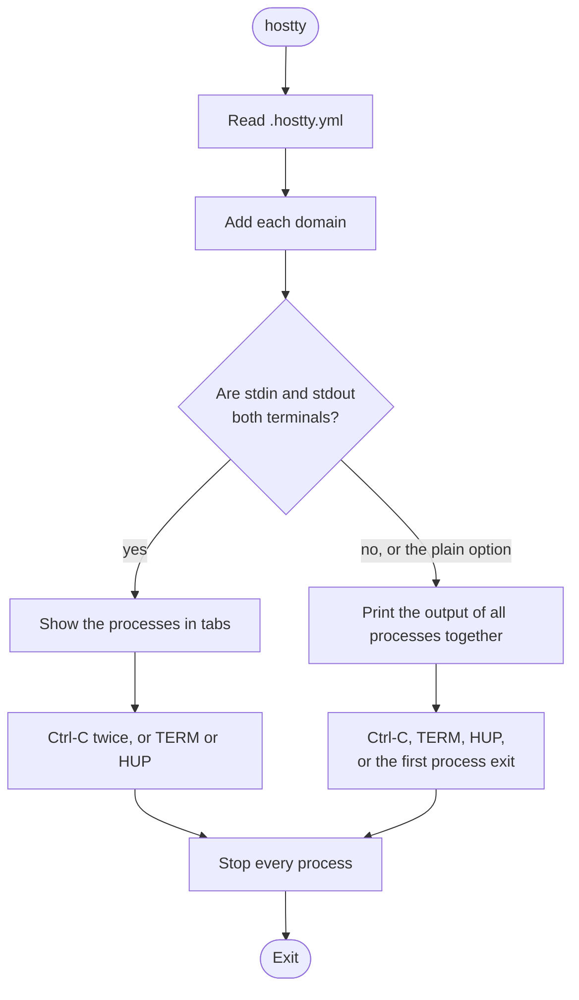

  <picture>
    <source media="(prefers-color-scheme: dark)" srcset="../assets/hostty-dark.svg">
    
  </picture>

# Features

### Contents

- [Pages](#pages)
- [How a Run Goes](#how-a-run-goes)

## Pages

- [Configuration](./configuration.md): the `.hostty.yml` file, ports, and environment variables.
- [Command Line](./command-line.md): the options and the exit codes.
- [Domains](./domains.md): local domains with NGINX and SSL.
- [Tabs](./tabs.md): the tab view, the keys, and the mouse.
- [Plain Output](./plain-output.md): the output of all processes together, for CI and pipes.
- [Stopping](./stopping.md): how hostty stops the processes.
- [Terminal Emulator](./terminal-emulator.md): which terminal features work inside a tab.

## How a Run Goes

Hostty keeps the domains after it exits.

---

[← Return to Hostty](../../README.md)
