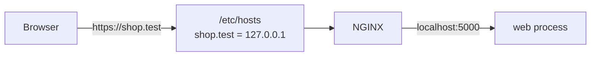

<p align="center">
  <picture>
    <source media="(prefers-color-scheme: dark)" srcset="../assets/hostty-dark.svg">
    
  </picture>
</p>

# Domains

### Contents

- [What a Domain Does](#what-a-domain-does)
- [NGINX Configs](#nginx-configs)
- [When Hostty Adds a Domain](#when-hostty-adds-a-domain)
- [Prompts](#prompts)
- [When a Domain Fails](#when-a-domain-fails)
- [Removing a Domain](#removing-a-domain)

## What a Domain Does

A process with a `domain` setting gets a local address, such as `https://shop.test`, that points to its port:

```yaml
processes:
  web:
    command: "bin/rails server -p $PORT"
    domain: "shop.test"
    ssl: true
```

[ruby-nginx](https://github.com/bert-mccutchen/ruby-nginx) does the work for each domain:

- It writes an NGINX server config that sends requests for the domain to the port of the process.
- It adds the domain to `/etc/hosts`.
- It makes an SSL certificate with mkcert, when `ssl` is `true`.
- It restarts NGINX.



The [process settings](./configuration.md#process-settings) table lists `ssl`, `log`, `host`, `root`, and `template`.

## NGINX Configs

The `template` setting picks the NGINX server config for the domain. It takes the name of a built-in config or the path to your own file:

| `template` | What NGINX does |
| --- | --- |
| Not set | Serves a file from `root` when one matches the path, and sends every other request to the process. |
| `"rails"` | Serves a file from `root` when one matches the path, and sends every other request to the process. `root` defaults to `public`. Allows uploads up to 4 GB and waits 30 minutes for a response, so a debugger can pause a request. |
| `"proxy"` | Sends every request to the process, and serves no files itself. Use it for a dev server that serves its own files, such as Jekyll or Vite. |
| A path, such as `"config/nginx.conf.erb"` | Uses your own file. The path is relative to the config file. |

```yaml
processes:
  web:
    command: "bin/rails server -p $PORT"
    domain: "shop.test"
    ssl: true
    template: "rails"
  docs:
    command: "bundle exec jekyll serve --port $PORT"
    domain: "docs.shop.test"
    template: "proxy"
```

Set `root` for any config that serves files. Without it, NGINX serves every file in the project directory, including secrets such as `.env`.

### Writing Your Own

Start from the [ruby-nginx default template](https://github.com/bert-mccutchen/ruby-nginx/blob/main/lib/ruby/nginx/templates/nginx.conf.erb). The template can use these values:

- `name`: a name for the upstream block, made from the domain.
- `options[:domain]`, `options[:port]`, `options[:host]`, and `options[:root_path]`.
- `options[:ssl]`, `options[:ssl_certificate_path]`, and `options[:ssl_certificate_key_path]`.
- `options[:log]`, `options[:access_log_path]`, and `options[:error_log_path]`.
- `options[:temp_path]`: a directory NGINX can write temp files to. Set `proxy_temp_path` and `client_body_temp_path` to it, or NGINX can fail with a permissions error.
- `nginx_version`: the installed NGINX version.

When the file does not exist, hostty prints the error and starts no process. A file named `rails` or `proxy` needs a path such as `"./rails"`, so hostty does not read it as a built-in config.

## When Hostty Adds a Domain

Hostty adds every domain before it starts any process. It prints one line per domain:

```text
12:00:01 hostty | Adding https://shop.test for web on port 5000.
```

Hostty adds the domains in your real terminal, before the tabs open, so every prompt can ask you for input.

## Prompts

Adding a domain can stop and ask you for input:

- ruby-nginx asks before it installs NGINX or mkcert, when either is missing. It needs both, even for a domain without `ssl`.
- `sudo` asks for your password, because editing `/etc/hosts` and restarting NGINX need root.

ruby-nginx updates `/etc/hosts` on every run, so the password prompt can come back on each start. Your `sudo` timeout decides how often it does.

## When a Domain Fails

When a domain fails, or you decline a prompt, hostty prints the error, starts no process, and exits with code 1:

```text
hostty: NGINX is required to continue. Please install NGINX.
```

ruby-nginx removes the domain that failed. The domains that hostty added before it stay in place.

## Removing a Domain

Hostty keeps every domain after it exits. To remove one, delete its line from `/etc/hosts` and its server config from `~/.ruby-nginx/servers`, then restart NGINX. The ruby-nginx command line can also remove a domain.

---

[← Return to Features](./README.md)
