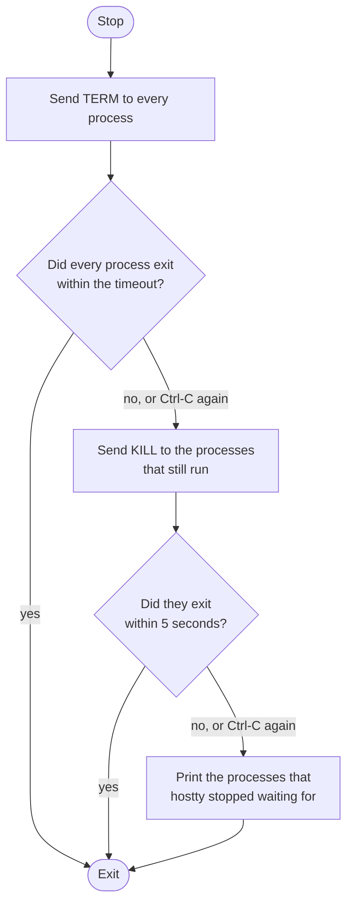

<p align="center">
  <picture>
    <source media="(prefers-color-scheme: dark)" srcset="../assets/hostty-dark.svg">
    
  </picture>
</p>

# Stopping

### Contents

- [What Stops Hostty](#what-stops-hostty)
- [How Hostty Stops the Processes](#how-hostty-stops-the-processes)
- [Child Processes](#child-processes)
- [Stopping Faster](#stopping-faster)

## What Stops Hostty

| Mode | What stops hostty |
| --- | --- |
| [Tabs](./tabs.md) | Ctrl-C twice within half a second, or TERM or HUP from another terminal. |
| [Plain output](./plain-output.md) | Ctrl-C, TERM, HUP, or the first process that exits. |

In tabs, hostty first leaves the tab view and gives you back your terminal. The lines below then print in your terminal.

## How Hostty Stops the Processes



Hostty prints each step:

```text
12:10:00 hostty | Stopping all processes.
12:10:00 hostty | web exited with code 143.
12:10:00 hostty | jobs exited with code 143.
```

When a process does not exit in time:

```text
12:10:10 hostty | Killing the processes that are still running.
```

The `--timeout` option sets the first wait. It defaults to 10 seconds. Give a slow process, such as Solid Queue finishing its running jobs, more time with a higher value.

## Child Processes

Hostty sends each signal to the whole process group of a process, so the processes that it started stop too. A Rails server with Puma workers, or a shell script with background jobs, stops in full.

A child process that starts its own session or process group leaves the group, so hostty cannot stop it.

## Stopping Faster

- During the wait after TERM, press Ctrl-C again, or send TERM again, to send KILL right away.
- During the wait after KILL, press Ctrl-C again, or send TERM again, to stop waiting and exit.

---

[← Return to Features](./README.md)
